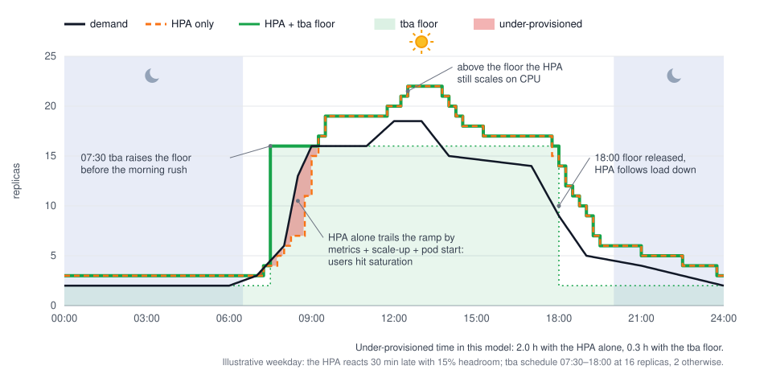
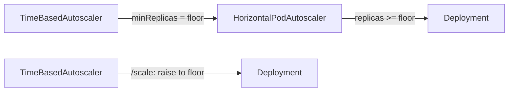
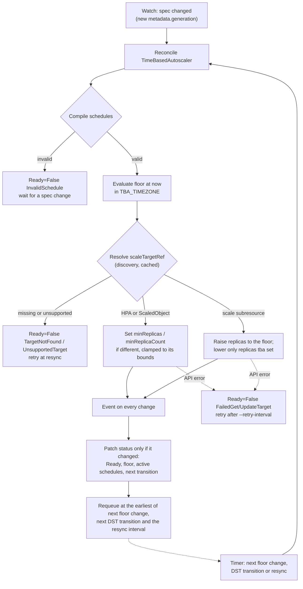

# tba: time based autoscaler for Kubernetes

`tba` is a Kubernetes controller that enforces **time-of-week replica floors**.
A `TimeBasedAutoscaler` declares weekly windows ("weekdays 08:00–18:00: at
least 10 replicas") and the controller keeps the scale target at or above the
floor that applies right now.

The floor is a **lower bound only**. CPU/memory `HorizontalPodAutoscaler`s,
KEDA, or a human can always scale above it; `tba` never scales below what they
asked for.

- Written in Rust, `#![forbid(unsafe_code)]`, clippy `pedantic` + `nursery` clean.
- 100% line and function coverage, enforced in CI.
- Benchmarked with hyperfine and profiled with samply ([docs/performance.md](docs/performance.md)).
- Supports every Kubernetes minor released in the last two years (1.32–1.37) and
  the current pre-release (1.38), each tested end to end on kind.

## Why a time-based floor

Reactive autoscalers act after load arrives: metrics must be scraped and
averaged, the HPA must decide, and new pods must schedule, pull and pass
readiness. On a predictable daily ramp that delay is spent saturated. `tba`
raises the floor ahead of the known ramp and releases it afterwards, while the
HPA keeps handling everything the schedule did not predict.



## How the floor is applied

| `scaleTargetRef` kind | What `tba` writes | Who scales above the floor |
|---|---|---|
| `HorizontalPodAutoscaler` (`autoscaling/v2`) | `spec.minReplicas` | the HPA, on CPU, memory or custom metrics |
| KEDA `ScaledObject` (`keda.sh/v1alpha1`) | `spec.minReplicaCount` | KEDA, on its triggers |
| Anything with a `scale` subresource (`Deployment`, `StatefulSet`, `ReplicaSet`, custom resources) | `spec.replicas` via `/scale` | anyone: manual scaling, CI, other controllers |

For scale-subresource targets, replicas below the floor are raised to it. When
the floor later drops, `tba` lowers replicas **only if it set the current value
itself** (tracked in `status.managedReplicas`); a scale-up by anyone else is
left untouched.

> If an HPA or KEDA already manages a workload, point the `TimeBasedAutoscaler`
> at the HPA or `ScaledObject`, not at the workload. Two controllers writing
> `spec.replicas` fight each other.



## Reconciliation cycle



Only the leader (a `coordination.k8s.io/v1` Lease) reconciles. Status writes do
not change `metadata.generation`, so they never trigger a reconciliation.

## Install

```sh
kubectl apply --server-side -k https://github.com/alexandernicholson/tba//deploy
```

This creates the `tba-system` namespace (Pod Security `restricted`), the CRD,
RBAC and a two-replica controller `Deployment` with leader election, a
`PodDisruptionBudget` and a metrics `Service`. The image is
`ghcr.io/alexandernicholson/tba`.

### Time zone

Schedules are evaluated in the IANA time zone given by the **`TBA_TIMEZONE`**
environment variable (default `UTC`), e.g. in a kustomize overlay:

```yaml
- op: replace
  path: /spec/template/spec/containers/0/env/0/value
  value: Europe/Berlin
```

or `kubectl -n tba-system set env deployment/tba-controller TBA_TIMEZONE=America/New_York`.
An unknown zone makes the controller exit at startup with an error.

## Example

```yaml
apiVersion: tba.alexandernicholson.github.io/v1alpha1
kind: TimeBasedAutoscaler
metadata:
  name: api
spec:
  scaleTargetRef:
    apiVersion: autoscaling/v2
    kind: HorizontalPodAutoscaler
    name: api
  minReplicas: 2            # floor outside every window
  schedules:
    - name: morning-peak
      days: [Monday, Tuesday, Wednesday, Thursday, Friday]
      start: "07:30"
      end: "10:00"
      minReplicas: 20
    - name: nightly-batch   # days default to every day
      start: "23:00"
      end: "02:00"          # end before start: crosses midnight
      minReplicas: 6
```

```console
$ kubectl get tba
NAME   KIND                      TARGET   FLOOR   ACTIVE             READY   AGE
api    HorizontalPodAutoscaler   api      20      ["morning-peak"]   True    3d
```

More in [examples/](examples/).

## API reference

`TimeBasedAutoscaler` (`tba.alexandernicholson.github.io/v1alpha1`, namespaced,
short name `tba`, category `autoscaling`).

### `spec`

| Field | Type | Description |
|---|---|---|
| `scaleTargetRef.apiVersion` | string | API version of the target, e.g. `apps/v1`. |
| `scaleTargetRef.kind` | string | Kind of the target. |
| `scaleTargetRef.name` | string | Name of the target, in the same namespace. |
| `minReplicas` | int ≥ 0 | Floor while no schedule is active. |
| `schedules[]` | list, ≤ 64, unique by `name` | Weekly windows. |
| `schedules[].name` | DNS label | Reported in `status.activeSchedules`. |
| `schedules[].days` | set of `Monday`…`Sunday` | Days the window **starts** on. Default: every day. |
| `schedules[].start` | `HH:MM` | Inclusive local start time. |
| `schedules[].end` | `HH:MM` or `24:00` | Exclusive local end time. Earlier than `start` means the window crosses midnight. Must differ from `start` (CEL-validated). |
| `schedules[].minReplicas` | int ≥ 0 | Floor while the window is active. |

Overlapping windows take the **highest** floor; `spec.minReplicas` applies
when it is higher than every active window. HPA floors are raised to 1 (the
HPA minimum) and every autoscaler floor is capped at its `maxReplicas`
(`maxReplicaCount`, default 100, for KEDA); `Ready` then reports reason
`FloorClamped`.

### `status`

| Field | Description |
|---|---|
| `observedGeneration` | Generation the status reflects. |
| `desiredMinReplicas` | Floor in effect. |
| `activeSchedules` | Windows in effect. |
| `nextTransitionTime` | Next instant the floor changes (absent if constant). |
| `managedReplicas` | Replicas `tba` last wrote to a `/scale` target and still owns. |
| `lastScaleTime` | Last time `tba` changed the target. |
| `conditions[type=Ready]` | `True` (`FloorApplied`, `FloorClamped`) or `False` (`InvalidSchedule`, `TargetNotFound`, `UnsupportedTarget`, `FailedGetTarget`, `FailedUpdateTarget`). |

Changes to the target are also reported as `events.k8s.io/v1` Events on the
`TimeBasedAutoscaler`.

### Time semantics

- Windows are wall-clock times in `TBA_TIMEZONE`, so they follow daylight saving
  time: a window starting at 08:00 starts at 08:00 local time all year.
- A start time skipped by a spring-forward gap takes effect when the clock jumps.
- In a fall-back fold, a boundary takes effect at each occurrence of the
  wall-clock time.
- The controller wakes exactly at the next floor change (and at every DST
  transition), and additionally every `--resync-interval` to correct drift such
  as manual scale-downs. There is no polling of schedules.

## Configuration

Every flag of `tba run` can be set through its environment variable.

| Flag | Environment | Default | Description |
|---|---|---|---|
| `--timezone` | `TBA_TIMEZONE` | `UTC` | IANA time zone for schedules. |
| `--namespace` | `TBA_WATCH_NAMESPACE` | all | Restrict the controller to one namespace. |
| `--resync-interval` | `TBA_RESYNC_INTERVAL` | `60s` | Upper bound between two reconciliations of an object. |
| `--retry-interval` | `TBA_RETRY_INTERVAL` | `15s` | Delay after a failed API request. |
| `--http-addr` | `TBA_HTTP_ADDR` | `0.0.0.0:8080` | `/healthz`, `/livez`, `/readyz`, `/metrics`. |
| `--leader-elect` | `TBA_LEADER_ELECT` | `true` | Lease-based leader election (`coordination.k8s.io/v1`). |
| `--lease-name` | `TBA_LEASE_NAME` | `tba-controller` | Lease name. |
| `--lease-namespace` | `POD_NAMESPACE` | client namespace | Lease namespace. |
| `--identity` | `POD_NAME` | host name | Holder identity and event reporter instance. |
| `--log-format` | `TBA_LOG_FORMAT` | `json` | `json` or `text`, to stderr. Level via `RUST_LOG`. |

The Kubernetes connection is configured like `kubectl`: in-cluster service
account, or `KUBECONFIG` / `~/.kube/config`.

### Additional scale targets

The controller's RBAC covers Deployments, StatefulSets, ReplicaSets, HPAs and
KEDA ScaledObjects. For a custom resource with a scale subresource, grant
access through the aggregated `tba-controller` ClusterRole:

```yaml
apiVersion: rbac.authorization.k8s.io/v1
kind: ClusterRole
metadata:
  name: tba-controller-rollouts
  labels:
    tba.alexandernicholson.github.io/aggregate-to-controller: "true"
rules:
  - apiGroups: ["argoproj.io"]
    resources: ["rollouts/scale"]
    verbs: ["get", "patch", "update"]
```

## Observability

- Probes: `/healthz` and `/livez` (liveness), `/readyz` (fails during shutdown).
- Metrics (OpenMetrics): `tba_reconcile_total{outcome}`,
  `tba_reconcile_duration_seconds`, `tba_target_updates_total{direction}`,
  `tba_leader`.
- On `SIGTERM` the controller stops accepting work, finishes in-flight
  reconciliations and releases its lease so a standby takes over immediately.
  Losing the lease makes the process exit so it restarts as a standby.

## Offline evaluation

`tba evaluate` shows what the controller would enforce, without a cluster:

```console
$ kubectl get tba -A -o json | tba evaluate -f - --timezone Europe/Berlin --at 2026-01-05T09:00:00+01:00
NAMESPACE  NAME  FLOOR  ACTIVE        NEXT
default    api   20     morning-peak  2026-01-05T10:00:00+01:00[Europe/Berlin]
```

It reads YAML streams, `List`s and JSON object streams (JSON decodes about 12×
faster) and prints tab-separated lines. `tba crd` prints the CustomResourceDefinition.

## Kubernetes compatibility

Only GA APIs are used: `apps/v1`, `autoscaling/v1` (scale) and `autoscaling/v2`,
`coordination.k8s.io/v1`, `events.k8s.io/v1`, `apiextensions.k8s.io/v1` with CEL
validation rules.

| Kubernetes | Status |
|---|---|
| 1.32, 1.33, 1.34, 1.35, 1.36, 1.37 | tested on kind in CI |
| latest pre-release (`dl.k8s.io/release/latest.txt`, currently 1.38.0-beta.0) | tested on a kind node image built from the release |

## Development

```sh
cargo test                      # unit, controller and binary end-to-end tests (no cluster needed)
scripts/coverage.sh             # fails below 100% line/function coverage
cargo clippy --all-targets -- -D warnings
scripts/bench.sh                # hyperfine, writes docs/benchmarks.md
scripts/e2e.sh kindest/node:v1.37.0   # full kind test
cargo run -- crd > deploy/crd.yaml    # regenerate the CRD after changing src/crd.rs
```

Tests run against an in-process fake API server (`tests/support/fake_api.rs`)
covering discovery, watches, the scale and status subresources, leases and
failure injection, so the whole controller, including leader election and
signal handling, is exercised without a cluster.

## License

[MIT](LICENSE)
